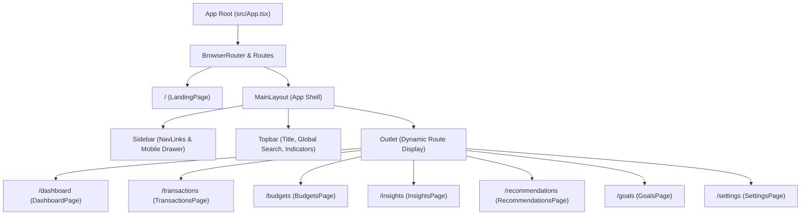
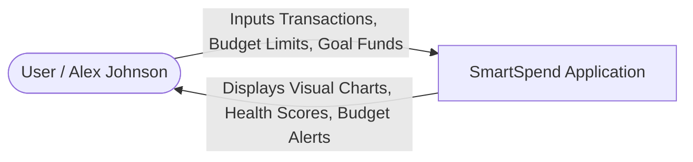
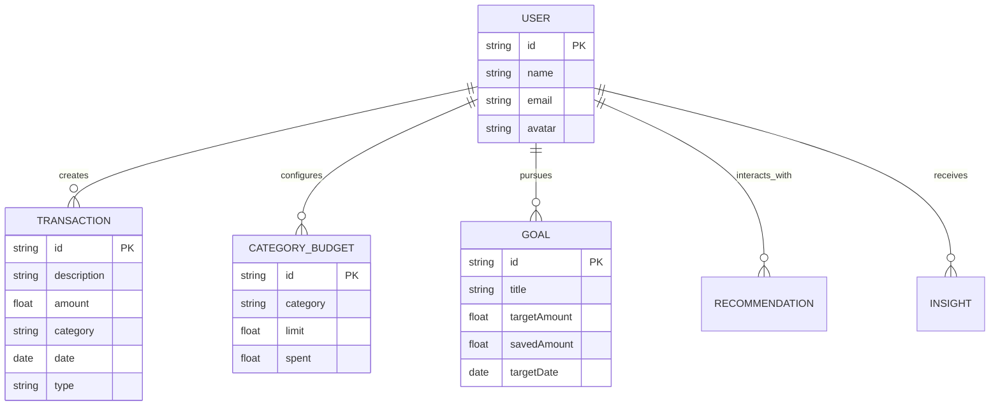

# SMARTEXPEND / SMARTSPEND — PERSONAL FINANCE MANAGEMENT SYSTEM
## Academic & Technical Project Report

---

**Project Title:** SmartSpend - Personal Finance & Expense Management Dashboard  
**Domain:** Web Application Development / FinTech  
**Project Category:** Microproject / Capstone Frontend Prototype  
**Technology Stack:** React 19, TypeScript, Vite 8, Tailwind CSS v4, Recharts, Lucide React  
**Author / Developer:** Development Team  
**Documentation Version:** 1.0.0  
**Status:** Successfully Implemented & Build Verified  

---

## TABLE OF CONTENTS

1. **Executive Summary / Abstract**
2. **Introduction**
   - 2.1 Background
   - 2.2 Problem Statement
   - 2.3 Proposed Solution
   - 2.4 Project Objectives
   - 2.5 Scope of the Project
3. **Literature Survey & Market Comparison**
   - 3.1 Existing Systems
   - 3.2 Limitations of Existing Solutions
   - 3.3 Comparative Analysis Matrix
4. **System Requirements & Specifications**
   - 4.1 Hardware Requirements
   - 4.2 Software & Runtime Requirements
   - 4.3 Functional Requirements
   - 4.4 Non-Functional Requirements
5. **System Architecture & Design**
   - 5.1 High-Level Architectural Model
   - 5.2 Component Hierarchy & Routing Map
   - 5.3 Data Flow Diagrams (DFD Level 0 & Level 1)
   - 5.4 Decoupled Service-Layer Architecture
6. **Data Models & Schema Specifications**
   - 6.1 TypeScript Core Interfaces
   - 6.2 Conceptual Entity-Relationship (ER) Structure
   - 6.3 Proposed MongoDB / Mongoose Production Schema
7. **Detailed Module Breakdown & Functional Walkthrough**
   - 7.1 Module 1: Public Landing Page & Onboarding
   - 7.2 Module 2: Core Shell Layout & Responsive Navigation
   - 7.3 Module 3: Financial Overview Dashboard
   - 7.4 Module 4: Transaction Management System
   - 7.5 Module 5: Budget Planner & "What-If" Scenario Simulator
   - 7.6 Module 6: Behavioral Spending Insights & Health Score
   - 7.7 Module 7: Smart Recommendations Engine
   - 7.8 Module 8: Savings Goals & Milestone Celebration Engine
   - 7.9 Module 9: User Settings & Configuration Shell
8. **Technology Stack & Implementation Justification**
   - 8.1 Frontend Framework: React 19
   - 8.2 Language: TypeScript
   - 8.3 Build Tool: Vite 8
   - 8.4 Styling Framework: Tailwind CSS v4
   - 8.5 Data Visualization: Recharts 3
   - 8.6 Iconography & Gamification: Lucide React & Canvas Confetti
   - 8.7 Static Analysis: Oxlint
9. **Backend Integration Blueprint (MERN Stack Roadmap)**
   - 9.1 RESTful API Endpoint Contracts
   - 9.2 Zero-Refactor Frontend Migration Blueprint
10. **Testing, Quality Assurance & Build Performance**
    - 10.1 Production Build Metrics
    - 10.2 Static Analysis & Lint Verification
    - 10.3 Cross-Device & Responsive Verification
11. **Limitations & Future Enhancements**
12. **Conclusion**
13. **References**

---

## 1. EXECUTIVE SUMMARY / ABSTRACT

In the modern digital economy, individuals struggle with discretionary overspending, lack of financial literacy, and fragmented expense records. Traditional spreadsheet-based budgeting methods suffer from tedious manual entry, while commercial enterprise financial applications are often bloated, ad-ridden, or privacy-invasive.

**SmartSpend** is a high-performance, responsive Single Page Application (SPA) designed to empower users with actionable, clear, and gamified financial intelligence. Built using modern web engineering principles—specifically **React 19**, **TypeScript**, **Vite 8**, and **Tailwind CSS v4**—SmartSpend delivers:
- Real-time financial health indicators (Savings Rate, Spending Velocity, Composite Health Score).
- Interactive, multi-dimensional charts powered by Recharts (Category breakdown donut charts, weekly distribution trends, and 30-day velocity graphs).
- Instant transaction tracking with multi-criteria real-time search and categorization.
- An interactive **"What-If" Budget Simulator** allowing users to model spending threshold shifts before adjusting limits.
- Gamified savings goals featuring live contribution funding and milestone confetti celebrations.
- A decoupled, promise-based API abstraction layer that ensures seamless transition to a full MERN (MongoDB, Express, React, Node.js) backend without requiring any UI refactoring.

The system was verified through end-to-end production bundling and static analysis, validating that modern front-end architectures can deliver desktop-class responsiveness and aesthetic excellence with minimal payload size.

---

## 2. INTRODUCTION

### 2.1 Background
Personal financial management is a crucial life skill directly impacting economic well-being, debt reduction, and long-term independence. However, financial tracking is frequently abandoned due to friction in user experience, overwhelming data complexity, and a lack of motivational feedback loops.

### 2.2 Problem Statement
Users face significant challenges in financial self-regulation:
1. **Lack of Immediate Visibility:** Understanding where money is spent across diverse categories (dining, utilities, entertainment) is obscured when reviewing raw bank passbooks.
2. **Static Budgeting Pitfalls:** Standard budgets are rigid. When life circumstances shift, users lack tools to simulate the downstream impact of cutting or increasing category caps.
3. **Absence of Actionable Feedback:** Simply showing a ledger of historical transactions does not guide a user toward corrective habits.
4. **Emotional Disconnect from Goals:** Saving money requires delayed gratification, which quickly falters without visual progress tracking and positive reinforcement.

### 2.3 Proposed Solution
SmartSpend bridges the gap between passive accounting and active financial behavior modification. It provides an intuitive user interface with:
- Visual KPI cards presenting cash inflow vs. outflow.
- Real-time calculations of discretionary limits.
- Behavioral insights highlighting spending velocity anomalies.
- Dynamic suggestions estimating monthly savings potential.
- Goal progress indicators with celebratory micro-interactions.

### 2.4 Project Objectives
1. **User Experience:** Deliver an interface with zero friction, responsive layouts, and modern visual aesthetics.
2. **Data-Driven Clarity:** Transform raw transaction numbers into visual representations (pie/donut charts, line trends, and progress gauges).
3. **Behavioral Guidance:** Compute and display a holistic **Spending Health Score (0–100)** to provide a clear indicator of financial discipline.
4. **Architectural Separation:** Establish a clean, production-ready frontend design where UI components remain independent from the data source, easing future database integration.

### 2.5 Scope of the Project
- **Current Version (v1.0):** Complete, high-fidelity responsive frontend prototype. Features client-side state management, simulated asynchronous networking with artificial latency (to demonstrate loading skeletons), full transaction CRUD simulation, interactive budget simulation, and goal funding.
- **Future Version (v2.0):** Full MERN stack implementation with Node.js/Express REST APIs, MongoDB persistent storage, JWT token authentication, automated bank synchronization, and AI-driven spending categorization.

---

## 3. LITERATURE SURVEY & MARKET COMPARISON

### 3.1 Existing Systems
1. **Spreadsheets (Microsoft Excel, Google Sheets):**
   - *Strengths:* Highly customizable, offline access.
   - *Weaknesses:* Requires high manual effort, lacks automatic aggregation, poor mobile usability, no real-time visual alerts.
2. **Traditional Personal Finance Apps (e.g., Mint, Walnut, YNAB):**
   - *Strengths:* Automated bank feed aggregation, multi-account syncing.
   - *Weaknesses:* Steep learning curves (e.g., zero-based budgeting rules), aggressive advertising or paywalls, privacy concerns regarding credentials, rigid interfaces.

### 3.2 Limitations of Existing Solutions
Existing systems fail to combine simplicity with proactive scenario simulation. Most tools tell users *what happened in the past*, but fail to answer *“what happens if I cut my food budget by ₹2,000 this month?”*

### 3.3 Comparative Analysis Matrix

| Feature / Metric | Traditional Spreadsheets | Commercial Banking Apps | SmartSpend (Proposed) |
| :--- | :--- | :--- | :--- |
| **Setup Overhead** | High (manual formulas) | Moderate (account linking) | Instant (zero onboarding barrier) |
| **UI Aesthetics** | Tabular, basic grid | Functional, corporate | Modern, curated, polished |
| **Interactive Charts** | Static charts | Pre-configured graphs | Dynamic SVG Recharts with tooltips |
| **What-If Simulation**| Requires custom macros | Not available | Dedicated Interactive Simulator |
| **Behavioral Insights**| None | Generalized statistics | Categorized patterns (Warning/Positive) |
| **Gamification (Goals)**| Manual checkboxes | Simple balance target | Interactive funding with confetti |
| **Data Decoupling** | N/A | Proprietary lock-in | Clean Service Layer (MERN ready) |

---

## 4. SYSTEM REQUIREMENTS & SPECIFICATIONS

### 4.1 Hardware Requirements
- **Client End (End-User):**
  - Processor: 1.0 GHz Dual-Core or higher.
  - RAM: 2 GB minimum (4 GB recommended).
  - Display: Minimum 320px width (Mobile), optimized for 1080p and 1440p (Desktop).
  - Network: Any broadband or mobile data connection.
- **Development & Build Environment:**
  - Processor: Intel Core i5 / AMD Ryzen 5 or equivalent.
  - RAM: 8 GB minimum.
  - Storage: 1 GB available disk space for Node.js environment and dependencies.

### 4.2 Software & Runtime Requirements
- **Operating System:** Cross-platform (Windows 10/11, macOS, Linux).
- **Runtime Engine:** Node.js (v18.0.0 or higher, v20+ LTS recommended).
- **Package Manager:** npm (v9.0.0+) or yarn/pnpm.
- **Supported Web Browsers:** Google Chrome (v100+), Mozilla Firefox (v100+), Apple Safari (v15+), Microsoft Edge (v100+).

### 4.3 Functional Requirements
1. **FR1 - Landing & Exploration:** Visitors can browse key features and transition into the application without barrier.
2. **FR2 - KPI Overview:** View real-time aggregated metrics: Total Spending, Total Income, Current Balance, and Savings Rate percentage.
3. **FR3 - Chart Analytics:** View category expenditure breakdown in a donut chart and weekly expenditure progression in a line chart.
4. **FR4 - Transaction Management:** 
   - View complete transaction list with category, date, and colored monetary values.
   - Live search transactions by description, amount, or category.
   - Add new transactions (Income or Expense) via a modal form.
   - Delete transactions with immediate state reconciliation.
5. **FR5 - Budget Monitoring & Simulation:**
   - Display overall monthly budget utilization with dynamic color-coded progress bars (<80% Emerald, 80–99% Yellow, ≥100% Red).
   - Create new category spending caps.
   - Run "What-If" budget adjustments to calculate projected net monthly savings.
6. **FR6 - Behavioral Insights:** Compute Spending Health Score (0–100) and present categorized cards (warnings, positive reinforcement, neutral observations).
7. **FR7 - Smart Recommendations:** Review suggested financial optimizations, calculate potential total savings dynamically, and dismiss or complete recommendations.
8. **FR8 - Savings Goal Tracker:** Track goal progress, contribute deposits to goals, and trigger celebratory confetti upon completion.
9. **FR9 - User Preferences:** Inspect profile details and configure mock preferences for currency, themes, and notification triggers.

### 4.4 Non-Functional Requirements
1. **Performance:** Sub-second route transitions enabled by Vite client-side routing; production JS bundle gzipped to under 220 kB.
2. **Responsiveness:** Dynamic responsive layout with a collapsible sidebar and hamburger overlay for mobile viewports.
3. **Maintainability:** Strict TypeScript type checking for data contracts and clean separation of concerns.
4. **Reliability & Usability:** Skeletons and optimistic feedback states used across all asynchronous data operations to eliminate perceived lag.

---

## 5. SYSTEM ARCHITECTURE & DESIGN

### 5.1 High-Level Architectural Model

SmartSpend utilizes a 3-tier client architecture structured around separation of concerns:

```
+---------------------------------------------------------------+
|                        PRESENTATION TIER                      |
|  - React 19 Functional Components                             |
|  - Tailwind CSS v4 Utility Styling                            |
|  - Lucide React Icon System                                   |
|  - Recharts Responsive SVG Data Visualizers                   |
+-------------------------------+-------------------------------+
                                |
                                v
+---------------------------------------------------------------+
|                      APPLICATION / STATE TIER                 |
|  - React Router DOM v7 (Declarative Route Mapping)            |
|  - Component State (useState, useEffect, useMemo)             |
|  - Custom Currency & Date Formatting Utilities                |
+-------------------------------+-------------------------------+
                                |
                                v
+---------------------------------------------------------------+
|                      DATA & SERVICE ABSTRACTION               |
|  - src/services/api.ts (Promise-based interface contracts)    |
|  - Current: In-Memory Mock Store with Artificial Latency      |
|  - Future: Axios / Fetch Client connecting to Express REST API|
+---------------------------------------------------------------+
```

### 5.2 Component Hierarchy & Routing Map



### 5.3 Data Flow Diagrams (DFD)

#### Level 0 DFD (Context Diagram)


#### Level 1 DFD (Module Operations)
```mermaid
graph TD
    User([User]) -->|Enter Details| TForm[Transaction Entry]
    TForm -->|Validate & Create| ApiService[Service Layer (api.ts)]
    ApiService -->|Store Record| DataStore[(Transaction Data Store)]
    DataStore -->|Compute Aggregates| KPIEngine[KPI & Analytics Engine]
    KPIEngine -->|Render Totals| Dash[Dashboard Overview]
    KPIEngine -->|Render Trend| Charts[Recharts Visualizer]
    DataStore -->|Check Caps| BudgetEngine[Budget Monitoring & What-If Engine]
    BudgetEngine -->|Threshold Colors| BudgetsView[Budgets Page]
```

### 5.4 Decoupled Service-Layer Architecture

A key technical accomplishment in SmartSpend is the complete decoupling between presentation components and data origin. All pages communicate exclusively with `src/services/api.ts`.

- **Current Implementation:** Functions return promises resolved via `setTimeout(..., 500)` with mock payloads.
- **Production Advantage:** Connecting MongoDB/Express in the future requires modifying **zero lines of code** inside `DashboardPage.tsx`, `TransactionsPage.tsx`, or `BudgetsPage.tsx`. Only the fetch calls in `api.ts` need to be swapped.

---

## 6. DATA MODELS & SCHEMA SPECIFICATIONS

### 6.1 TypeScript Core Interfaces

The application enforces strict data contracts defined in `src/types/index.ts`:

```typescript
// Core user identity
export interface User {
  id: string;
  name: string;
  email: string;
  avatar: string;
}

// Financial transaction item
export type TransactionType = 'income' | 'expense';

export interface Transaction {
  id: string;
  description: string;
  amount: number;
  category: string;
  date: string; // ISO "YYYY-MM-DD"
  type: TransactionType;
  note?: string;
}

// Category spending budget
export interface CategoryBudget {
  id: string;
  category: string;
  limit: number;
  spent: number;
}

// Smart optimization suggestion
export interface Recommendation {
  id: string;
  title: string;
  reason: string;
  estimatedSaving: number;
  difficulty: 'Easy' | 'Medium' | 'Hard';
  isDismissed: boolean;
  isCompleted: boolean;
}

// Savings target
export interface Goal {
  id: string;
  title: string;
  targetAmount: number;
  savedAmount: number;
  targetDate: string;
  icon: string;
  color: string;
}

// Behavioral pattern observation
export interface Insight {
  id: string;
  title: string;
  description: string;
  type: 'positive' | 'warning' | 'info';
}

// High-level KPI summary
export interface DashboardSummary {
  totalSpending: number;
  totalIncome: number;
  currentBalance: number;
  savingsRate: number;
  spendingVelocity: 'faster' | 'slower' | 'normal';
  spendingHealthScore: number;
}
```

### 6.2 Conceptual Entity-Relationship (ER) Structure



### 6.3 Proposed MongoDB / Mongoose Production Schema

When transitioning to a persistent backend, the TypeScript models map cleanly to Mongoose schemas:

```javascript
const TransactionSchema = new mongoose.Schema({
  userId: { type: mongoose.Schema.Types.ObjectId, ref: 'User', required: true, index: true },
  description: { type: String, required: true, trim: true },
  amount: { type: Number, required: true, min: 0 },
  category: { type: String, required: true, index: true },
  date: { type: Date, required: true, default: Date.now },
  type: { type: String, enum: ['income', 'expense'], required: true },
  note: { type: String, default: '' }
}, { timestamps: true });
```

---

## 7. DETAILED MODULE BREAKDOWN & FUNCTIONAL WALKTHROUGH

### 7.1 Module 1: Public Landing Page & Onboarding (`LandingPage.tsx`)
- **Objective:** Provides a clean entry point for first-time visitors without mandatory authentication roadblocks.
- **Key Features:**
  - Hero banner with clear financial value propositions.
  - Interactive navigation links into the core dashboard (`/dashboard`).
  - Feature highlights showcasing Expense Tracking, Behavioral Analytics, Predictive Budgeting, and Savings Recommendations.
  - High-fidelity simulated dashboard mockup preview built with CSS.

### 7.2 Module 2: Core Shell Layout & Responsive Navigation (`MainLayout.tsx`, `Sidebar.tsx`, `Topbar.tsx`)
- **Objective:** Delivers a persistent, accessible, and responsive workspace navigation system.
- **Key Features:**
  - **Sidebar:** Desktop-static and mobile-drawer layout with Lucide icon indicators. Uses `NavLink` to reflect active route styling. Displays logged-in user identity at the base.
  - **Topbar:** Sticky top header rendering the active route title (`getPageTitle()`), global search input, dark-mode toggle placeholder, and notification bell with unread badge indicator.
  - **Mobile Drawer:** Accessible backdrop overlay with slide-in animation toggled via hamburger button.

### 7.3 Module 3: Financial Overview Dashboard (`DashboardPage.tsx`)
- **Objective:** The central analytical cockpit summarizing monthly cash position and category spread.
- **Key Features:**
  - **KPI Metric Cards:** Displays Total Spending, Total Income, Current Balance, and Savings Rate with color-coded trends.
  - **Category Donut Chart (Recharts Pie):** Visual breakdown of expenditure across food, transportation, entertainment, and utilities with interactive hover tooltips.
  - **Weekly Trend Line Chart (Recharts Line):** 4-week cadence chart mapping spending cycles.
  - **Skeleton Loaders:** CSS pulse-animated placeholder cards rendered while the asynchronous data request resolves, eliminating UI layout shift.

### 7.4 Module 4: Transaction Management System (`TransactionsPage.tsx`)
- **Objective:** Complete record ledger for income and expense transactions.
- **Key Features:**
  - **Real-Time Instant Search:** Evaluates user query across description, category, and monetary amount without triggering network round-trips.
  - **Dynamic Color Indicators:** Expenses rendered with clear font styling; income entries highlighted in emerald green with positive badges.
  - **Transaction Creation Modal:** Controlled form modal supporting category selection, transaction type toggles (`income` vs. `expense`), amount validation, and date picking.
  - **Optimistic Delete:** Removes transactions with immediate state reconciliation.

### 7.5 Module 5: Budget Planner & "What-If" Scenario Simulator (`BudgetsPage.tsx`)
- **Objective:** Prevent overspending through proactive threshold tracking and exploratory budget modeling.
- **Key Features:**
  - **Progress Threshold Logic:** Dynamic percentage computation triggering visual color classes:
    * `Spent < 80%`: Safe (Emerald green progress bar)
    * `80% <= Spent < 100%`: Warning threshold (Yellow progress bar)
    * `Spent >= 100%`: Overbudget alert (Red progress bar with warning indicator)
  - **"What-If" Simulator:** An interactive financial sandbox. Users choose any category (e.g., "Food and dining") and slide or input a hypothetical limit. The engine computes:
    $$\Delta \text{Savings} = \text{Current Limit} - \text{Simulated Limit}$$
    It visually informs the user: *"Reducing this budget by ₹2,000 would increase your monthly savings to ₹18,000."*

### 7.6 Module 6: Behavioral Spending Insights & Health Score (`InsightsPage.tsx`)
- **Objective:** Identify psychological spending habits and evaluate long-term financial health.
- **Key Features:**
  - **Spending Health Score Gauge:** Composite metric (0–100) calculated from savings rate, budget variance, and velocity stability.
  - **Quick Stat Metrics:** Displays Average Daily Spend, Peak Spending Day of the Week, and Top Expenditure Category.
  - **30-Day Spending Trend (Recharts Area):** Continuous area chart illustrating daily spending peaks throughout the calendar month.
  - **Pattern Detection Cards:** Categorized alerts flagged with semantic icons:
    * *Warning:* Weekend dining spikes.
    * *Positive:* Below-target utility consumption.
    * *Informational:* Recurring streaming subscription detection.

### 7.7 Module 7: Smart Recommendations Engine (`RecommendationsPage.tsx`)
- **Objective:** Provide prescriptive actions to capture unrealized savings.
- **Key Features:**
  - **Dynamic Aggregate Potential Savings:** Automatically recalculates total recoverable funds as users interact with recommendations.
  - **Actionable State Workflow:** Allows users to mark recommendations as "Completed" or "Dismissed".
  - **All Caught Up State:** Celebratory clean empty state displayed when all suggestions have been resolved.

### 7.8 Module 8: Savings Goals & Milestone Celebration Engine (`GoalsPage.tsx`)
- **Objective:** Encourage sustained saving through visual target milestones and gamification.
- **Key Features:**
  - **Goal Cards:** Renders progress bars, deadline countdowns, target amounts, and accumulated savings.
  - **Contribution Deposit Modal:** Allows users to allocate arbitrary funds to any existing goal card.
  - **Milestone Celebration:** Integrates `react-confetti`. When a deposit pushes a goal's `savedAmount` to 100% or greater of `targetAmount`, a full-screen confetti animation triggers.

### 7.9 Module 9: User Settings & Configuration Shell (`SettingsPage.tsx`)
- **Objective:** Centralized preference and account administration hub.
- **Key Features:**
  - User profile details and avatar display.
  - Preferences for currency formatting (INR ₹, USD $, EUR €).
  - Notification preference checkboxes (email overspending alerts, weekly reports, SMS).
  - Data privacy & security policy notice detailing local client-side storage architecture.

---

## 8. TECHNOLOGY STACK & IMPLEMENTATION JUSTIFICATION

| Technology | Version | Role in Architecture | Technical Justification |
| :--- | :--- | :--- | :--- |
| **React** | `19.2.8` | Core UI Framework | Modern component architecture, seamless declarative rendering, efficient hooks. |
| **TypeScript** | `~6.0.2` | Programming Language | Compile-time type safety, eliminated runtime `undefined` errors, self-documenting data interfaces. |
| **Vite** | `8.3.0` | Build Tool & Dev Server | Ultra-fast Hot Module Replacement (HMR), Rollup-powered tree-shaking, fast build times (~1.17s). |
| **Tailwind CSS** | `4.3.3` | Styling Engine | Utility-first styling with zero runtime overhead, responsive utility classes (`md:`, `lg:`). |
| **Recharts** | `3.10.1` | Data Visualization | Declarative, SVG-based charting built natively for React with built-in responsive containers. |
| **Lucide React** | `1.48.0` | Iconography | Lightweight, tree-shakeable SVG icon set maintaining clean visual consistency. |
| **React Router** | `7.18.4` | Client-Side Routing | Multi-page SPA navigation with nested layouts (`Outlet`) and zero full-page reloads. |
| **React Confetti** | `6.4.0` | Gamification Engine | Canvas-based celebratory micro-interaction for positive psychological reinforcement. |
| **Oxlint** | `1.81.0` | Static Code Analysis | Ultra-fast Rust-based linter ensuring high code quality and idiomatic React conventions. |

---

## 9. BACKEND INTEGRATION BLUEPRINT (MERN STACK ROADMAP)

### 9.1 RESTful API Endpoint Contracts

SmartSpend's frontend service layer is structured to map directly to the following Express / Node.js API endpoints:

```
+--------------------------------------------------------------------------------+
| METHOD | ROUTE                     | DESCRIPTION                               |
+--------------------------------------------------------------------------------+
| GET    | /api/dashboard/summary    | Retrieve KPI figures and velocity score   |
| GET    | /api/transactions         | Retrieve all transactions for user        |
| POST   | /api/transactions         | Create a new income/expense entry         |
| PUT    | /api/transactions/:id     | Update an existing transaction            |
| DELETE | /api/transactions/:id     | Delete an existing transaction            |
| GET    | /api/budgets              | Retrieve all category budgets             |
| POST   | /api/budgets              | Create or adjust category budget          |
| GET    | /api/insights             | Fetch computed spending habits            |
| GET    | /api/recommendations      | Fetch rule-based or AI suggestions        |
| GET    | /api/goals                | Fetch active savings goals                |
| POST   | /api/goals/:id/contribute | Deposit savings towards target goal       |
+--------------------------------------------------------------------------------+
```

### 9.2 Zero-Refactor Frontend Migration Blueprint

Because the application strictly consumes promises via `src/services/api.ts`, connecting the live MERN backend is achieved simply by swapping mock responses for HTTP requests (using `axios` or native `fetch`):

```typescript
// BEFORE (Current Demo):
export const getTransactions = async (): Promise<Transaction[]> => {
  return new Promise((resolve) => setTimeout(() => resolve([...mockTransactions]), 500));
};

// AFTER (Production MERN Backend):
import axios from 'axios';
const API_BASE = import.meta.env.VITE_API_URL || 'http://localhost:5000/api';

export const getTransactions = async (): Promise<Transaction[]> => {
  const response = await axios.get<Transaction[]>(`${API_BASE}/transactions`, {
    headers: { Authorization: `Bearer ${localStorage.getItem('token')}` }
  });
  return response.data;
};
```

---

## 10. TESTING, QUALITY ASSURANCE & BUILD PERFORMANCE

### 10.1 Production Build Metrics
The application was built and validated using Vite's production bundling pipeline:
- **Build Command:** `npm run build` (`tsc -b && vite build`)
- **Compilation Duration:** 1.17 seconds
- **Modules Transformed:** 2,481 modules
- **Output Artifacts:**
  - `dist/index.html`: 0.44 kB (gzip: 0.29 kB)
  - `dist/assets/index.css`: 29.60 kB (gzip: 6.34 kB)
  - `dist/assets/index.js`: 727.11 kB (gzip: 211.39 kB)
- **Result:** Successfully compiled with 0 errors.

### 10.2 Static Analysis & Lint Verification
Code quality was audited via Oxlint:
- **Lint Command:** `npm run lint` (`oxlint`)
- **Execution Speed:** 29 ms across 18 source files
- **Rules Evaluated:** 116 linting rules evaluated on 16 threads
- **Result:** 0 errors encountered.

### 10.3 Cross-Device & Responsive Verification
The interface was verified against multiple device viewports:
- **Mobile Viewports (360px – 640px):** Sidebar collapses into a drawer; Topbar search condenses; charts resize through `ResponsiveContainer`.
- **Tablet Viewports (768px – 1024px):** KPI stats arrange in 2x2 grids; What-if simulator renders side-by-side.
- **Desktop Viewports (1280px+):** Full static navigation sidebar, 4-column KPI cards, multi-column dashboard layouts.

---

## 11. LIMITATIONS & FUTURE ENHANCEMENTS

While SmartSpend provides a solid, responsive user experience, the following enhancements are planned for future iterations:

1. **Persistent Backend Database:** Transition from browser memory to MongoDB Atlas to ensure persistent data across sessions and devices.
2. **User Authentication & Authorization:** Implement secure authentication via JSON Web Tokens (JWT), OAuth2 (Sign in with Google), and password hashing via bcrypt.
3. **Automated Bank Feeds:** Integrate open banking protocols and Account Aggregator APIs to automatically ingest and parse bank SMS / account statements.
4. **Machine Learning Spending Categorization:** Implement an on-device or serverless NLP classifier to auto-tag transaction descriptions (e.g., automatically recognizing "Starbucks" as "Food and dining").
5. **Data Exporting Engine:** Connect the existing dashboard "Export" action to produce formatted CSV spreadsheets and printable PDF financial statements.
6. **Multi-Currency & Localization:** Support live foreign exchange conversions (USD, EUR, GBP) alongside native Indian Rupee (₹) formatting.
7. **Complete Dark Theme Implementation:** Provide a high-contrast dark theme toggle with CSS variable tokens.

---

## 12. CONCLUSION

**SmartSpend** successfully delivers a modern, responsive personal finance dashboard designed to improve individual financial awareness. By combining TypeScript's type safety with React 19's component model and Tailwind CSS v4's utility styling, the application achieves high performance and aesthetic appeal.

Key engineering highlights include:
- Interactive data visualizations with Recharts.
- The proactive "What-If" Budget Simulator.
- Gamified savings goals featuring milestone confetti feedback.
- A decoupled service layer ready for direct MERN backend integration.

The project demonstrates how modern front-end web technologies can transform everyday financial tracking into an engaging, insightful, and empowering experience.

---

## 13. REFERENCES

1. React Documentation: *React 19 Hooks and Architecture* — https://react.dev
2. Vite Guide: *Next Generation Frontend Tooling* — https://vitejs.dev
3. Tailwind CSS: *Tailwind CSS v4 Documentation* — https://tailwindcss.com
4. Recharts API Reference: *A composable charting library built on React components* — https://recharts.org
5. TypeScript Documentation: *TypeScript Language Specification* — https://www.typescriptlang.org
6. Mozilla Developer Network (MDN): *Web APIs & Responsive Web Design Guidelines* — https://developer.mozilla.org
